# Spawnbox architecture

How Spawnbox works today: Linux hosts running many Firecracker microVMs
behind one HTTP API. Hosts without KVM run each sandbox in gVisor instead
(see [Hosts without KVM: gVisor](#hosts-without-kvm-gvisor)). One host is
enough; more hosts join a primary as workers (see
[More than one host](#more-than-one-host)).

- [The big picture](#the-big-picture)
- [Components](#components)
- [What a sandbox is](#what-a-sandbox-is)
- [Templates and snapshots](#templates-and-snapshots)
- [Creating a sandbox](#creating-a-sandbox)
- [Talking to the guest](#talking-to-the-guest)
- [Pause and resume](#pause-and-resume)
- [Volumes](#volumes)
- [Hosts without KVM: gVisor](#hosts-without-kvm-gvisor)
- [Networking](#networking)
- [Secrets](#secrets)
- [Preview URLs](#preview-urls)
- [Tenants, keys and quotas](#tenants-keys-and-quotas)
- [Events and usage](#events-and-usage)
- [More than one host](#more-than-one-host)
- [State on disk](#state-on-disk)
- [Crash recovery and shutdown](#crash-recovery-and-shutdown)
- [Security boundaries](#security-boundaries)

## The big picture

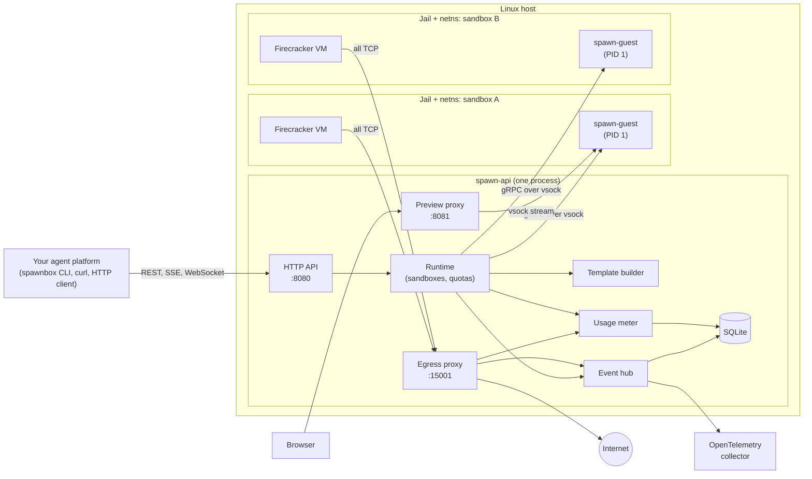

The host runs one process, `spawn-api`. It serves the API, starts and
stops VMs, proxies preview traffic and every outbound TCP connection, and
records events and usage in SQLite. Each sandbox is a Firecracker microVM
with a small agent, `spawn-guest`, as its init process. The host talks to
the agent over vsock, a socket between a VM and its host, not over the
network.

## Components

The Rust workspace has one crate per part:

| Crate | Runs where | Role |
| --- | --- | --- |
| `spawn-api` | Host | HTTP API, auth, tenants, quotas, sandbox lifecycle, templates, secrets, previews, events, usage, SQLite |
| `spawn-node` | Host (library) | Builds template snapshots and restores, pauses and resumes jailed Firecracker VMs or gVisor containers; per-sandbox network namespaces and firewall rules |
| `spawn-egress` | Host (library) | Transparent TCP proxy: egress policy, connection logging, TLS interception for secret injection |
| `spawn-guest` | Inside every VM | PID 1: mounts the root overlay, sets up the network, keeps services running and starts the agent, which serves gRPC (exec, files, terminals, ports, identity, services) |
| `spawn-proto` | Both | The gRPC contract between host and guest |
| `spawn-bench` | Host | Boot, snapshot and restore benchmark |
| `spawnbox-cli` | Anywhere | The `spawnbox` command: an HTTP and WebSocket client for the API, and `doctor` host checks, including whether the data directory is on an encrypted disk |

Outside the workspace: `guest/kernel` (a Linux 6.18 LTS config for
Firecracker), `guest/images/debian` (the Debian 13 base disk), and pinned
Firecracker, jailer and gVisor (`runsc`) releases. `scripts/build-artifacts.sh` builds or
downloads all of these.

## What a sandbox is

A sandbox is one Firecracker microVM, wrapped in layers of isolation:

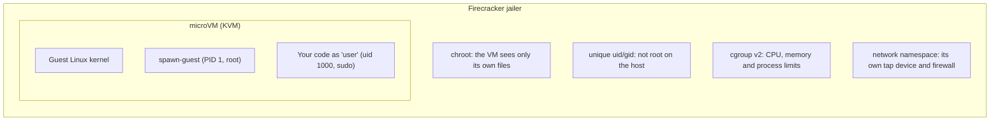

Inside the VM, the root filesystem is an overlay of up to three disks:

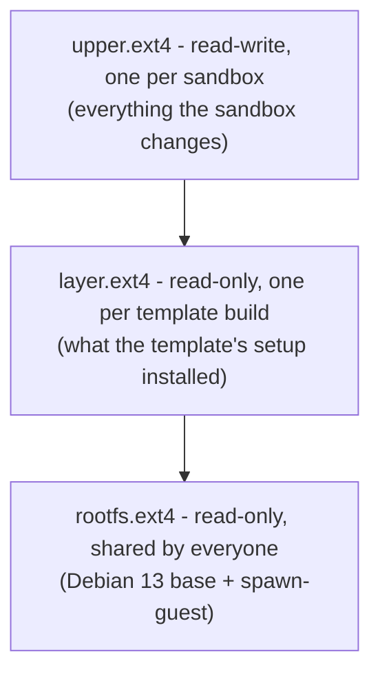

The read-only disks are shared, so the host page cache holds one copy of
them for every sandbox. A new sandbox only needs a fresh copy of the small
upper disk. This is like `node_modules` symlinked from a shared cache:
shared files are read-only, and each project only stores what it changed.

## Templates and snapshots

Sandboxes are not booted. They are restored from a snapshot of a VM that
already booted, which is what makes them start in tens of milliseconds.

```mermaid
flowchart LR
    t["POST /v1/templates<br/>setup, warmup, env, resources"] --> q["Build queue<br/>(--max-builds at a time)"]
    q --> boot["Boot a VM from<br/>kernel + base disk"]
    boot --> setup["Run setup<br/>as root, with network"]
    setup --> seal["Seal the changes into<br/>a read-only layer.ext4"]
    seal --> reboot["Boot again on<br/>base + layer"]
    reboot --> warm["Run warmup as user<br/>(start background services)"]
    warm --> snap["Pause and snapshot:<br/>vm.mem, vm.state, upper.ext4"]
    snap --> ready["Build ready:<br/>new sandboxes use it"]
```

- `base` has no setup steps and is built when the server starts.
- Saving a template again queues a new build. Sandboxes keep using the
  last ready build until the new one finishes.
- A build is kept across restarts. It is rebuilt only when the kernel, base
  disk or Firecracker version changes, because a snapshot only restores
  on the same versions.
- A build that a persistent sandbox's start record names is kept until
  that sandbox is deleted.

### Build store

With `--build-store`, ready builds are also kept in an S3-compatible object
store (`crates/spawn-api/src/store.rs`). Think of it like a lockfile plus a
package registry: the build's key is a hash of everything that went into
it, so the same key always means the same build.

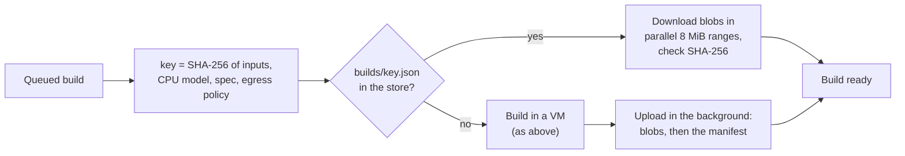

- **Layout.** `builds/<key>.json` lists the build's files with their
  SHA-256 and size. `blobs/<sha256>.zst` holds one file, zstd-compressed.
  A file that two builds share is stored once.
- **Sparse files.** Disks are mostly holes: a 20 GiB `upper.ext4` may hold
  4 MiB. A blob holds only the data parts, found with `SEEK_DATA` and
  `SEEK_HOLE`, and a download writes the file back sparse.
- **Local cache.** With `--build-cache-gib`, when `builds/` is larger than
  the limit, idle builds that are in the store lose their files, least
  recently used first. A build in use by a create or a warm pool, or used
  in the last 10 minutes, is kept. The next create fetches it again. If a
  fetch fails, the template is built again.
- **Clean-up.** Once a day each host rewrites the manifests it uses.
  Primaries then delete manifests and unreferenced blobs that are older
  than 7 days, except builds that a start record names. Workers do not
  delete: they do not know every start record.

## Creating a sandbox

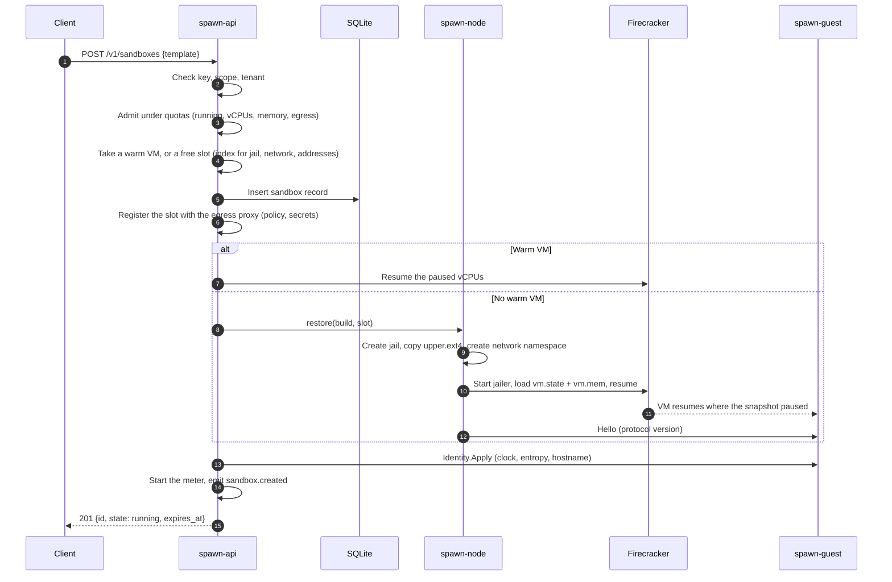

Every VM restored from one snapshot starts with the same clock, random
seed and hostname. `Identity.Apply` fixes that, so clones never share
random numbers or keys. On the test host a create takes about 60 to 75 ms
from a build and about 8 ms from a warm VM.

### Warm pools

A warm VM is the restore part done ahead of time: jail, upper disk,
network namespace, snapshot loaded, guest agent connected, then vCPUs
paused. Like a pool of database connections, it is opened before anyone
asks for it.

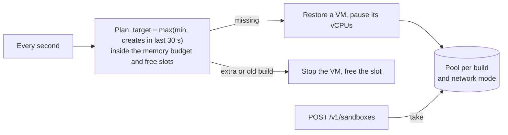

- The sandbox ID of a warm VM is chosen when it is restored, so its jail,
  network namespace and log already have the right names.
- Pools are separate for each network mode, because the namespace firewall
  depends on it. A tenant's own template has its own build, so a warm VM is
  never shared between tenants.
- A pool whose build is replaced is stopped. Warm VMs are not saved: a
  restart removes them and fills the pools again.

## Talking to the guest

The host never reaches the guest over a shared network. Each call opens a
vsock connection to port 1024 in the VM and speaks gRPC on it. Under
gVisor it is a TCP connection to port 1024 on the sandbox's private link
instead (see [gVisor](#hosts-without-kvm-gvisor)).

| Guest service | Used by |
| --- | --- |
| `Health.Hello` | Version handshake on every connection |
| `Identity.Apply` | Every create and resume |
| `Process.Exec` | `POST /exec` (streamed stdout, stderr, exit) and `git:clone` |
| `Files` (`Stat`, `Read`, `Write`, `List`, `Remove`) | `/files` |
| `Pty.Open` | The terminal WebSocket |
| `Ports.Dial` | The preview proxy, to reach a port inside the VM |
| `Image.Seal` | Template builds |
| `Services` (`Start`, `List`, `Restart`, `Logs`, `Watch`) | Services; see [Services](#services) |

The agent runs commands with the user's uid and gid, so file permissions
work as usual. The host treats everything the guest sends as untrusted:
message sizes are capped and output is truncated.

## Pause and resume

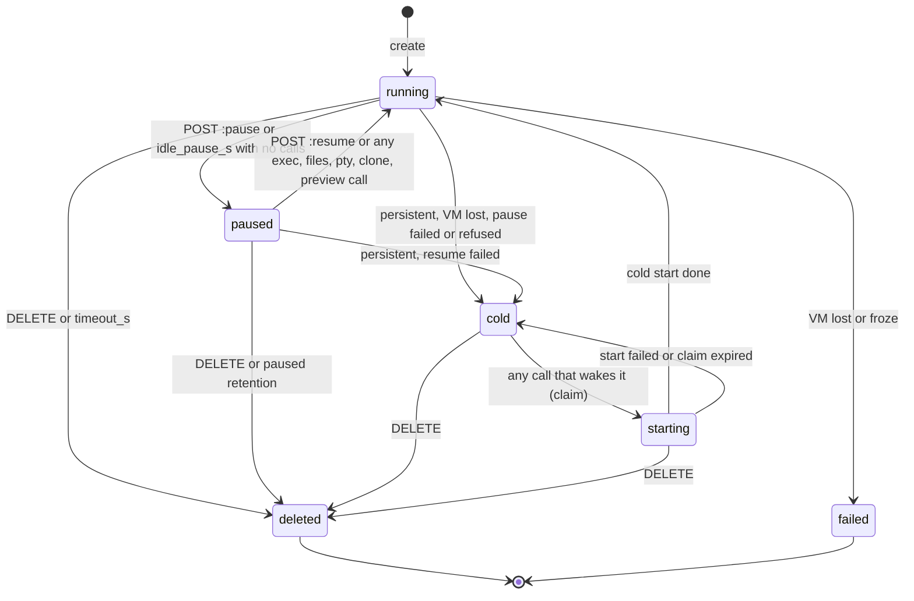

- **Pause** snapshots the VM's memory and state, keeps its upper disk, and
  moves them to `<data-dir>/paused/<id>`. Then it stops the VM and frees
  its slot, CPU and memory. Running processes and published ports
  survive.
- **Resume** restores that snapshot into a fresh jail and network
  namespace, then reapplies identity so the clock is right.
- Paused time does not count toward `timeout_s`, and paused sandboxes
  survive server restarts.
- Each network namespace gives the guest's gateway the same fixed MAC
  address, so a resumed guest's cached ARP entry still works.
- The env of a paused sandbox is sealed with ChaCha20-Poly1305 under
  `secrets.key`. One blob holds the sandbox env and the env of every
  service, so no value can be moved to another variable or service
  without breaking the tag. The associated data is a format version, the
  tenant and the sandbox ID. A fork seals the copy's env under its new ID.
- At start, the lease holder seals env that earlier versions stored in
  plain or in separate blobs (`reseal.rs`). Rows changed meanwhile are
  left for the next start. SQLite runs with `secure_delete`. Pages that
  earlier versions freed still hold plain env, so the first start after
  the upgrade runs `VACUUM` once (an `upkeep` row marks it as due) and
  truncates the WAL. On Postgres, old row versions stay until `VACUUM`.
- Rows sealed this way look empty to earlier versions, which would then
  overwrite them. So the same migration renames `sandboxes.saved` to
  `saved_state`: earlier versions fail at start on the missing column
  before they change anything. On Postgres, a trigger also refuses the
  lower `schema_version` that earlier versions write. Both databases
  refuse a schema version newer than the binary knows. Downgrades past
  this version are not supported.
- If the key cannot open some stored env, the server refuses to start
  unless `--allow-unreadable-env` is set. Even then, those paused
  sandboxes keep their state and snapshot files, so a start with the
  right key resumes them. The flag cannot help with a wholly different
  key: the egress CA key, stored secrets and the Postgres shared files
  are sealed with it too, and fail to open later in the start. It is
  for a key that is right for everything except some env rows.
- Memory files and disks are not encrypted; `spawnbox doctor` warns when
  `<data-dir>` is not on a dm-crypt disk.

### Persistent sandboxes

A persistent sandbox has no timeout and is never deleted by retention.
Instead of `failed` or `deleted`, it becomes `cold` when its memory is
lost. A cold sandbox has no VM.

- **Start record.** The create writes a start record in the same
  transaction as the sandbox row. It holds the template, build, a copy of
  the template spec, limits, network rules, secret names, volumes,
  `idle_pause_s`, published ports, and the sandbox's own env and services,
  sealed like above. A resume does not clear it. Publishing a port updates
  it.
- **Protected env.** A sandbox created with env values, its own or a
  service's, cannot be snapshotted to a template: the template spec would
  show them. The snapshot gives `409 protected_env`. Forks keep the flag.
- **Build roots.** A build in a start record is a root. The host keeps
  it, and the build store does not collect it, even after a newer build of
  the template is ready. A root build (`builds.root`) is one made only for
  cold starts; it is never a template's current build, and it is removed
  10 minutes after no start record names it.
- **Cold start.** A call that wakes a cold sandbox moves its row from
  `cold` to `starting` in one conditional update. That update adds 1 to
  `generation` and writes a claim with a 120 s deadline. Calls on this
  host wait for the same start. The start restores the build into a new
  jail, with new secret placeholders and the env from the start record.
  It does not use warm VMs: their jail and network have another ID. Only
  an update for the same generation and claim makes the row `running`.
  If the start fails or the deadline passes, the row goes back to `cold`
  and the new VM is stopped.
- **Delete.** A delete of a `cold` or `starting` sandbox marks it deleted
  at once. A start that ends later fails its update and stops its VM.
- **Generations.** Calls in progress and lifecycle updates carry the
  generation they started with. An update from an older generation does
  nothing.
- **Placement.** Creates place persistent sandboxes on the primary.
  Moving or draining one gives `409 conflict`. In a fleet, a cold start
  can run on any worker; see [Lost hosts and fencing](#lost-hosts-and-fencing).
  So a persistent sandbox changes host, including to a host with another
  fingerprint, only by becoming cold and starting there, never by a
  snapshot copy.

### Old builds and upgrades

A build records the protocol version of its guest (`builds.guest`, read
when the build's snapshot is taken; unknown for builds fetched from the
store or made by earlier releases). A host accepts a guest of the same
major version and at most two minor versions apart.

- **Resume.** Before a paused persistent sandbox resumes, the host reads
  the guest of its start record's build. If the host does not accept it,
  or the restored guest's handshake says so, the snapshot is dropped and
  the row becomes `cold` (`sandbox.cold`, `guest_too_old`). `open` and
  `:resume` then cold-start it.
- **Choosing the build.** A cold start uses the start record's build if
  its guest is accepted and its files are here or in the build store.
  Otherwise, under a per-host lock keyed by SHA-256 of the template, the
  spec without `min_warm` and registry secrets, and the fingerprint, it
  takes the newest ready build with that template, spec and fingerprint
  whose guest is accepted and whose files are reachable. With none, it
  queues a root build of the recorded spec and runs it like a template
  build: if the build store has a build with the same key, it is fetched
  instead, and a new build is uploaded. Concurrent cold
  starts wait on the same lock, so they share one build.
- **Adopting it.** The start record's `build` (and the row's) moves to
  the new build in one update, conditional on the old build. The host
  holds the new build, and the old one is released when no record names
  it. The event `sandbox.rebuilt` has `from_build`, `to_build` and
  `reason` (`missing`, `outdated` or `guest_too_old`), and
  `spawnbox_sandbox_rebuilds_total{reason}` counts it.
- **Waiting.** On the primary, the call waits up to 60 s, before it
  claims the row. After that it gives `503 rebuilding` (retryable) and the
  build continues; the next call takes it. A worker's cold-start route
  does not wait at all: it gives `rebuilding` at once, so the primary's
  claim covers only the boot. The primary passes that `503` on.
- **Start budget.** A cold start's boot gets the claim's 120 s less the
  time the start already spent, measured from when the call arrived. With
  less than 10 s left it gives `503 no_capacity` before it claims the
  row, so a start never runs past the claim that the primary holds. A failed build gives `409 build_failed`, the row
  stays `cold`, and the failure is returned for 5 minutes before another
  build is tried. Snapshot templates cannot be built again, so they fail
  at once.
- **Shared database.** Primaries on one Postgres see each other's build
  rows. A row whose files are neither on this host nor in the store is
  not usable, so a new leader builds the spec again or takes its own
  build of the same spec.

## Services

A service is a program that the guest keeps running. The host sends the
whole list, and the guest makes its services match it.

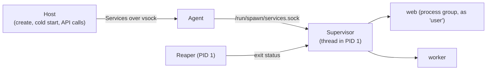

- **Where it runs.** The supervisor is a thread in PID 1, not in the
  agent. PID 1 restarts the agent when it stops, so services outlive the
  agent. The agent forwards the host's `Services` calls to the
  supervisor's Unix socket, which only root can open.
- **Reaping.** PID 1 must reap all orphans with `waitpid(-1)`. One reaper
  thread does this, and gives the exit status of a child that it knows,
  the agent or a service, to the code that started it. Other statuses are
  dropped.
- **Start.** `Start` has the full list. A service with the same name and
  spec is left alone. A changed one is restarted. A new one starts and a
  removed one stops. A repeated `Start` never starts a second copy.
- **Env.** The host merges each service's env: the CA variables, the
  template env, the sandbox env, the secret placeholders, then the
  service env. The create refuses a service env that sets a CA variable
  or a secret's variable.
- **Restarts.** A stopped service starts again after 1 s, doubling to
  30 s. The wait goes back to 1 s after 60 s of uptime. A health check
  that fails `failures` times one after the other restarts the service.
  A stop sends `SIGTERM` to the process group, then `SIGKILL` after 5 s.
- **Logs.** Each service's stdout and stderr go to
  `/var/log/spawnbox/<name>.log`. When the file passes 1.25 MiB, it is
  cut to its last 1 MiB.
- **When they start.** The host sends `Start` after the create's fixups
  and after a cold start, only when there are services. A pause keeps
  the processes and the supervisor's state in memory, so a resume does
  not send it again. A guest without `Services` gives `Unimplemented`;
  the host stops the new VM and answers `409 conflict`.
- **Events.** For each running sandbox with services, the host keeps a
  `Watch` stream open and turns the guest's changes into
  `service.started`, `.exited`, `.unhealthy` and `.restarted` events. A
  watch ends when the VM pauses or stops, and opens again after a resume.
  A watch after a create or cold start begins from the last event before
  `Start`, so no event is lost.
- **Storage.** The service list is sealed with the sandbox env in the
  start record and the saved row of a paused sandbox, because the service
  env can hold secrets. API responses, events and logs show only names.
- **Previews.** The service `port` is published with its `access` when
  the sandbox is created. A preview request to that port asks the guest
  for the service's state and waits up to 30 s for it to be healthy.
- **Fleet.** Service calls are routed to the sandbox's host like exec.
  A move sends the services with the saved state.

## Volumes

A volume is a sparse ext4 file on the host, `<data-dir>/volumes/<id>.ext4`.
It outlives every sandbox that mounts it. Think of it as a named Docker
volume: the container (sandbox) is thrown away, the volume stays.

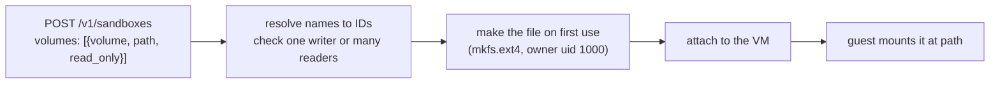

- **Rows.** The `volumes` table holds `id`, `tenant`, `name`, `size_gib`,
  `backend` and `node`. `backend` stays empty until the first mount; then
  the file is made and the volume is tied to that backend. A sandbox row
  keeps its mounts as JSON, in slot order.
- **One writer or many readers.** `insert_sandbox` checks every volume in
  the same SQLite transaction that adds the sandbox: a writer needs no
  other users; a reader needs no writer. Ended sandboxes do not count.
- **Firecracker.** Every VM has the same eight extra drives, so a
  snapshot loads into any jail: `vdc`–`vdf` read-write slots and
  `vdg`–`vdj` read-only slots (`vdk` is the template layer). Unused slots
  point at tiny placeholder files. A cold restore or a warm VM gets its
  volumes by `PATCH /drives`; the guest waits until each disk shows its
  real size, then mounts it at `/spawn/vol/<slot>` and binds it to the
  path.
- **gVisor.** The host loop-mounts each volume and gives the container
  four bind mounts. A warm container cannot get new binds, so creates
  with volumes on gVisor start cold.
- **Flush.** Before stop and before pause, the agent runs `sync`. A
  Firecracker kill drops the guest page cache, so without this the last
  writes would be lost.
- **Pause, resume, move.** A paused sandbox keeps its volumes; resume
  attaches the same files. A move sends the volume files in the package
  with the snapshot.
- **Usage.** The full `size_gib` counts as disk, each hour, with the
  volume ID as the usage key. The `volume_storage_gib` quota caps the sum
  per tenant.

## Hosts without KVM: gVisor

Firecracker needs KVM, and most cloud VMs do not have it. On those hosts
Spawnbox runs each sandbox with [gVisor](https://gvisor.dev) (`runsc`)
instead. `--backend auto` (the default) picks Firecracker when `/dev/kvm`
opens read-write and gVisor otherwise. Every API works the same on both;
only the box around the guest changes.

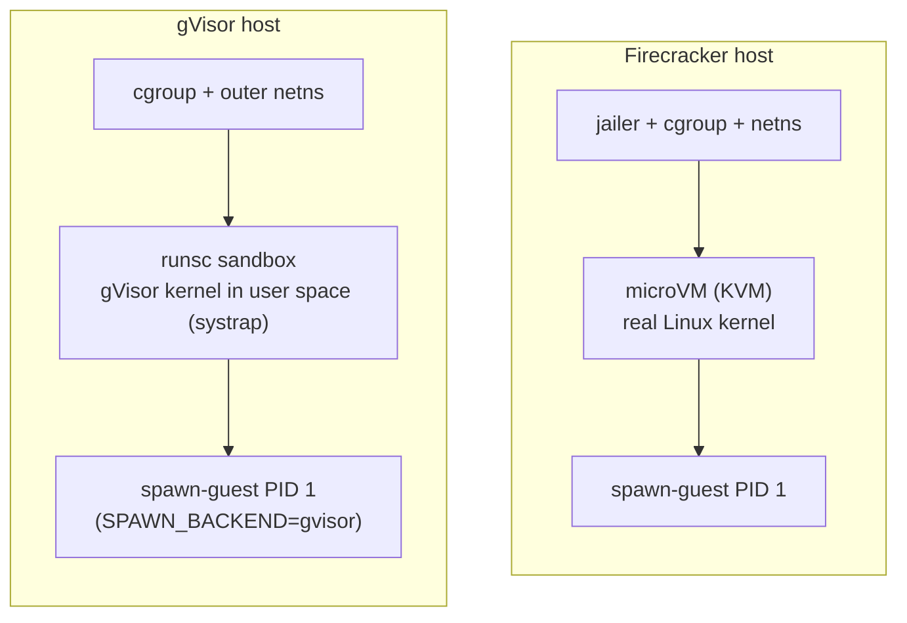

gVisor is a kernel written as a normal program. The sandbox's system
calls go to it, not to the host kernel, and it makes only a small set of
host calls itself. Think of it as a strict proxy in front of the host
kernel: much better than a plain container, but weaker than a microVM,
where the CPU hardware draws the line. Tenants that need a microVM set
`isolation: "microvm-only"`.

How each part maps:

| Part | Firecracker | gVisor |
| --- | --- | --- |
| Root disk | Overlay of `rootfs.ext4`, `layer.ext4` and a per-sandbox `upper.ext4`, inside the guest | The host loop-mounts `rootfs.ext4` and `layer.ext4` read-only, joins them with overlayfs into an OCI bundle, and gVisor adds its own writable layer (`--overlay2`), backed by a file in the bundle |
| Host to agent | vsock port 1024 | TCP `172.16.0.2:1024`, dialled from the sandbox's network namespace. The agent accepts only `172.16.0.1`. |
| Snapshot files | `vm.state`, `vm.mem`, `upper.ext4` | `checkpoint.img`, `pages.img`, `pages_meta.img` (writes are inside the checkpoint) |
| Warm pool freeze | `PATCH /vm` Paused | `runsc pause` |
| Template build | Boot the kernel, run setup, snapshot | Run setup in a container whose writable layer is `layer.ext4`, then boot from it and checkpoint |
| Limits | cgroup of the jailer, memory + VMM overhead | cgroup `spawnbox/<id>`, exactly the sandbox memory, because gVisor shows the cgroup limit as the guest's RAM |
| Disk metering | Blocks of `upper.ext4` | Blocks of gVisor's deleted layer file, read through `/proc/<pid>/fd` |
| Volumes | Extra drives, swapped in with `PATCH /drives` | Host loop mounts, passed in as bind mounts |

Networking needs one extra step. `runsc` takes every interface in the
namespace it joins and removes their addresses. So each gVisor sandbox
gets two namespaces: the usual outer one with the firewall and the egress
redirect, and an inner one for `runsc`, joined by a veth pair:

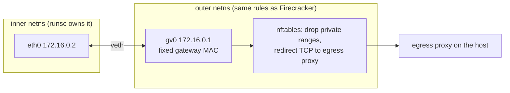

The guest still sees the same addresses and gateway MAC as a microVM, so
checkpoints restore into any fresh pair of namespaces.

Moves between hosts work on gVisor too, but only between hosts with the
same backend: a host's fingerprint covers the backend, base disk, `runsc`
binary and egress CA (and the kernel and Firecracker on Firecracker
hosts). Known limits under gVisor: programs that need kernel features
gVisor does not implement (kernel modules, some `/proc` and `/sys` files,
some `ioctl`s) fail inside the sandbox.

## Networking

Every VM gets the same addresses inside its own namespace. The namespace's
index makes the host side unique.

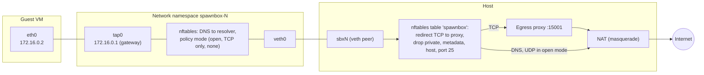

- **Every TCP connection** leaving a sandbox is redirected to the egress
  proxy. The proxy finds the original destination, identifies the sandbox
  by its source address, and decides.
- **Policy.** The server, tenant and sandbox policies all apply; the
  strictest wins.
  - `allow_all` allows any public address.
  - `allowlist` reads the TLS SNI or HTTP `Host` name and allows only
    listed names on ports 80 and 443.
  - `deny_all` blocks everything, including DNS.
- **Always blocked:** private and link-local ranges (including cloud
  metadata at 169.254.169.254), loopback, the host's own addresses and
  SMTP port 25.
- **DNS** to the gateway is forwarded to `--dns`.
- **Logging and quotas.** Every connection is logged and becomes a
  `net.connection` or `net.blocked` event. Its bytes are metered for the
  tenant, and a tenant over its monthly egress quota gets new connections
  refused.

## Secrets

Secrets let code use an API key without ever seeing it.

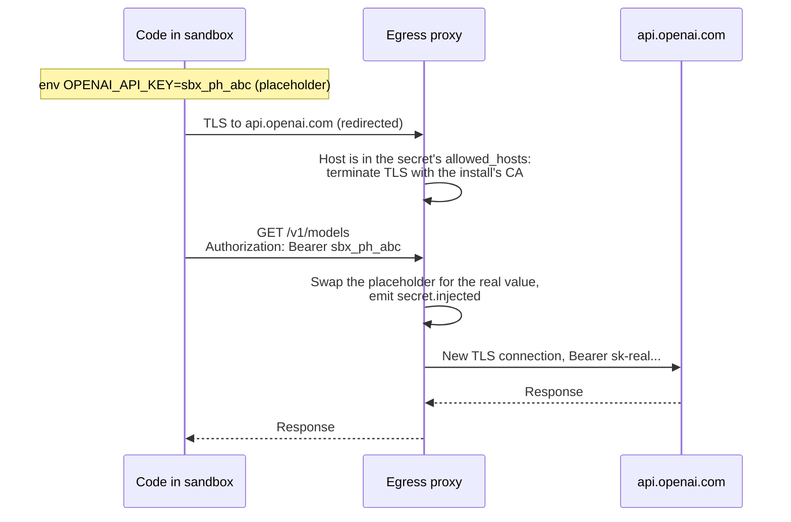

- Values are encrypted at rest with ChaCha20-Poly1305 under
  `<data-dir>/secrets.key`. The egress CA's private key is encrypted the
  same way.
- Every VM trusts the egress CA, so intercepted TLS is accepted. Only
  connections to a secret's `allowed_hosts` are intercepted; all other
  TLS passes through untouched.
- Requests to other hosts only ever carry the placeholder, so a prompt
  injection that sends the variable elsewhere leaks nothing useful.
- `git_https` secrets work the same way for `git clone` with Basic auth.

## Preview URLs

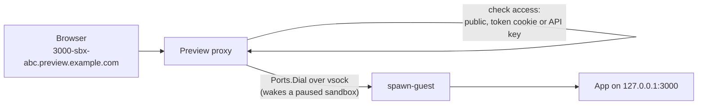

The first label of the host name says which port and sandbox to reach.
Traffic reaches the app through vsock, not the VM's network, so apps
bound to `localhost` work and no sandbox address is exposed. HTTP/1.1 and
WebSockets are forwarded.

## Tenants, keys and quotas

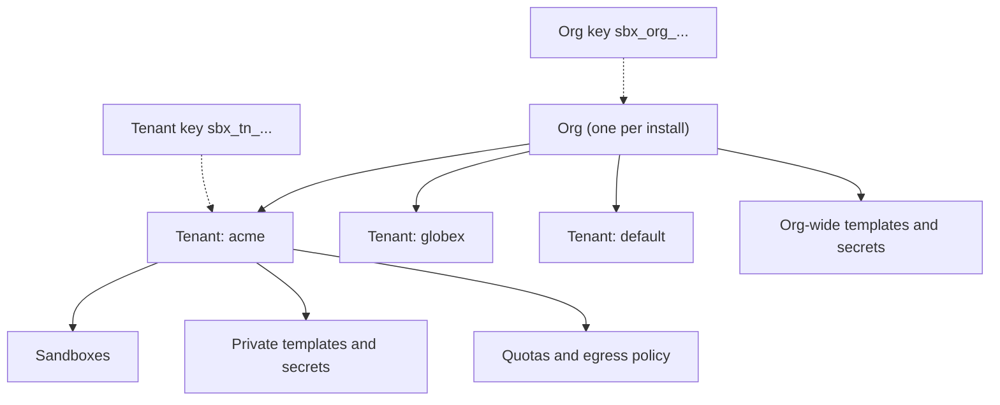

- Each request is checked in order: hash the key, find its tenant and
  scopes, check the scope for the route, then make sure the resource
  belongs to that tenant. Another tenant's resources return `404`, so their
  IDs are not revealed.
- **Isolation.** A tenant's `isolation` is `any` or `microvm-only`. A
  `microvm-only` tenant's sandboxes go only to Firecracker hosts; a gVisor
  host refuses them with `503 no_capacity`.
- **Admission.** Create and resume count the tenant's running and starting
  sandboxes against `running_sandboxes`, `running_vcpus` and
  `running_memory_mib` under one lock, so parallel requests cannot
  overshoot. Pause works the same way for `snapshot_storage_gib`. An idle
  sandbox that the quota refuses keeps running, except a persistent one:
  it stops and becomes `cold` with the reason `pause_failed`.

## Events and usage

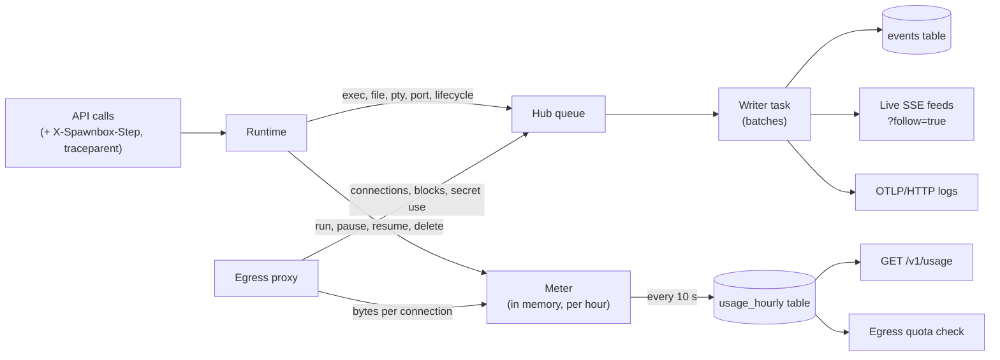

- **Events.** API calls only queue an event, so they never wait on the
  database. One writer task stores events in batches, then fans them out
  to live followers and OpenTelemetry.
- **Steps.** A step ID from the request header tags every event that call
  causes. Network events take the step of the exec or terminal that was
  running, but only when exactly one was.
- **Usage.** Each running sandbox is charged its reserved vCPU and memory.
  Disk is charged by bytes actually stored: the upper disk while running,
  the snapshot while paused. Charges are split at UTC hour boundaries,
  kept in memory, and added to SQLite every 10 seconds and at shutdown.

## More than one host

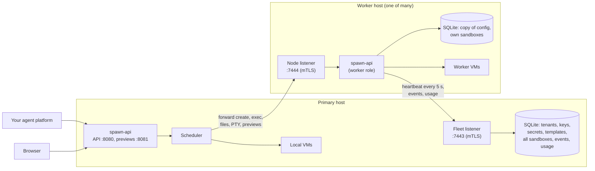

The same binary runs in one of three roles:

- **Single** (default): one host, as in the rest of this document.
- **Primary** (`--fleet-listen`): a single host that also takes workers.
  It owns tenants, keys, secrets and templates, places sandboxes, and
  forwards calls. It runs sandboxes too.
- **Worker** (`--primary`): runs sandboxes for the primary. It serves only
  its node listener, which takes only the primary's certificate. Clients
  never call it.

**Joining.** The primary keeps a small certificate authority in
`<data-dir>/fleet/`, its private key encrypted with the secrets key. An
admin makes a one-time join token. The worker sends the token, a
certificate request and its URL to the primary, and checks the primary's
CA by the SHA-256 it was given. The primary uses up the token, adds a node
row and signs a certificate for the new node ID (`nod_...`). From then on,
both sides use mutual TLS: the primary checks that the worker's
certificate names the node it wants, and the worker accepts only the
primary's certificate.

**Heartbeats.** Every 5 seconds a worker sends its capacity (backend, free
slots, free memory, ready templates with a hash of their spec, warm VMs per
template and network mode), its config version, and every sandbox it has.
That list is the full inventory: a worker sandbox the primary knows that
is missing from it for 30 seconds is marked deleted with `sandbox.lost`.
No heartbeat for 15 seconds makes the node `suspect` (no new sandboxes);
30 seconds makes it `down` (calls for its sandboxes return
`503 node_unreachable`). Its rows stay, as it can come back. Persistent
rows are not ended by a missing report; see
[Lost hosts and fencing](#lost-hosts-and-fencing).

**Config.** Every change to tenants, keys, secrets or templates bumps a
config version. A worker with an old version asks the primary for the
full set and applies it in one transaction: tenants, key hashes, template
specs (each worker builds them itself), and the current values of the
secrets that it holds. Before a create, the primary pushes the secrets
that the sandbox attaches.

**Placing a sandbox.** The primary checks the tenant's quota against its
own sandboxes, the worker sandboxes it knows, and creates in flight. Then
it scores each ready host that has the template and room, skipping gVisor
hosts for `microvm-only` tenants: a warm VM gives
+100, free memory up to +30, and fewer sandboxes of the same tenant up to
+10. It tries the best three in turn. A local pick runs as on one host. A
remote pick forwards the original HTTP request to the worker; the reply
becomes a **mirror row** in the primary's `sandboxes` table, with the
node's ID.

**Forwarding.** After auth, a call for a sandbox with a mirror row that
has not ended goes to its worker as the same HTTP request. Bodies stream,
and a WebSocket upgrade (the terminal) is joined both ways. Preview
requests are forwarded too, marked for the worker's preview router. The
worker checks the API key again against its copy. Calls for ended
sandboxes are answered by the primary.

**Events and usage.** Workers send new events every second with their own
IDs; the primary stores them once each by `(node, ID)` and gives them its
own IDs, so `/v1/events` and its streams cover every host. Every minute
workers send their hourly usage totals; the primary keeps the larger value
of each field, so a late report changes nothing. Monthly egress and
snapshot quotas are counted per host, so a tenant can pass them by a
little.

**Drain and migration.** `POST /v1/nodes/{id}:drain` sets `draining` on
the node row; placement skips it. With `{"migrate":true}` a background
task moves its sandboxes, running ones first, and records `node.drained`.
`POST /v1/sandboxes/{id}:migrate` moves one. The primary drives every
move; workers never call each other:

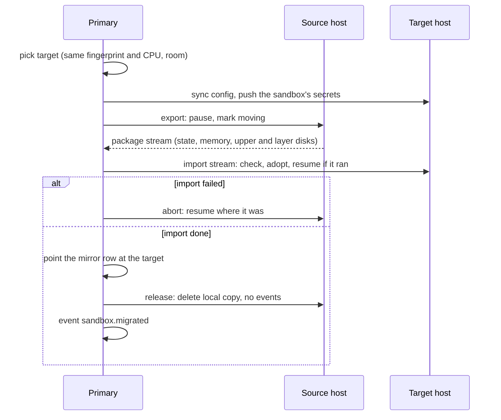

- The **package** is one zstd stream with a checksum: a JSON header (the
  saved record, fingerprint, CPU), then each file, then a SHA-256 of the
  whole stream. The base rootfs is not sent: hosts with the same
  **fingerprint** (SHA-256 of kernel, base rootfs, Firecracker and egress
  CA certificate) have the same one, and the target hard-links its own.
  That is why workers fetch the primary's egress CA at start and use it
  in place of their own.
- The target stages the files in `paused/.incoming-*` and renames them in
  place. Leftovers from a crash are removed at start.
- While a sandbox moves, API and preview calls for it wait (up to 2
  minutes) and its idle and timeout timers stop. A local `moving` flag
  makes resume and delete return `409` on the source.
- A move pauses for a moment; there is no live migration. Moves between
  CPU models are refused, as a snapshot depends on CPU features.
- **Env.** Workers need not share `secrets.key`. The source opens the
  saved env and sends it in plain inside the package, only over the
  fleet's mutual TLS. The target seals it under its own key and refuses a
  package with a sealed env.
- **Safety.** A moved ID stays in the heartbeat `keep` list for 60
  seconds, so a late heartbeat does not mark it lost. If a worker still
  reports a sandbox that now lives elsewhere, the heartbeat reply tells
  it to `release` the stale copy. A failed import aborts the source; if
  the target adopted it anyway, the next heartbeat releases it there.

**Autoscaling.** With `--autoscale-hook`, a task on the primary
(`fleet/autoscale.rs`) checks every 10 s. Load is the larger of used
slots and used memory over the primary and ready, undrained workers. A
pure `decide()` turns the load trend into wait, scale up, scale down or
cancel a scale down, one change at a time. Scale up makes a join token
and runs the hook. Scale down drains the emptiest worker with
migration, and runs the hook and removes the node only when it has no
sandboxes or volumes. Requests live in `scale_requests`, so a restart
resumes them.

**Volumes in a fleet.** A volume's file lives on one host, its **home**
(`node` in its row; empty is the primary). Every sandbox that mounts it
runs on that home, so the home's database is where the one-writer rule is
checked. The primary's rows are the source of truth; workers keep copies
of the rows for the files they hold.

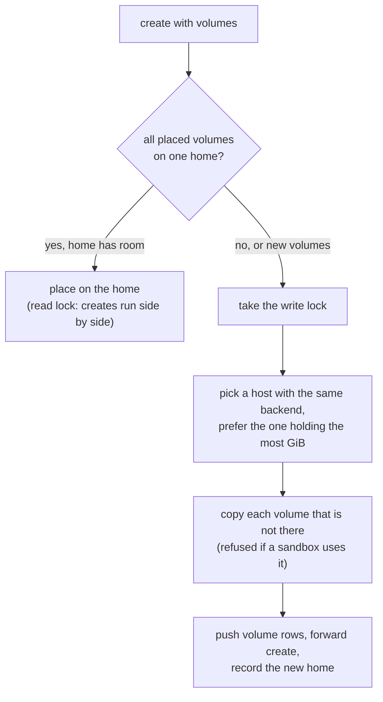

- **Copy** reuses the move package: the source streams a one-file
  package, the primary pipes it to the target, the target stages it and
  renames it in place. Then the primary records the new home and tells
  the source to drop its file.
- **Moves** take the write lock and need the sandbox to be the only user
  of its volumes. After the move, each volume's home is the target.
- **Drain** moves the sandboxes, then copies the volumes no sandbox uses
  to the host with the same backend and the most free memory.
- **Delete** marks the row deleted on the primary and tells the home to
  remove the file.

**Lost hosts and fencing.** A `down` node may only be cut off from the
primary and still run its VMs. Starting a persistent sandbox again
elsewhere could run its programs twice. So the primary makes a lost
node's persistent rows `cold` only with a proof that their VMs are gone.

```mermaid
flowchart TB
    down["worker down or removed,<br/>persistent rows stay"] --> proof{"proof?"}
    proof -- "worker reports them stopped or missing" --> cold["row: cold, node empty<br/>sandbox.cold"]
    proof -- "report said self_fence, and<br/>fence_after_s + margin passed" --> cold
    proof -- "autoscaler removed the machine" --> cold
    proof -- "POST /v1/nodes/{id}:fenced" --> cold
    proof -- "none" --> wait["503 node_unreachable"]
    cold --> next["next call: primary claims<br/>generation + 1, places, forwards"]
```

- **Generations.** A cold start adds 1 to `generation` with its claim.
  The primary applies a heartbeat row of a persistent sandbox only at the
  current generation and on the node in its row, and never moves a row
  out of `cold`, `starting` or `deleted`. A worker copy with another
  generation or node is stale: the heartbeat reply lists it, and the
  worker kills its cgroup and drops it (`sandbox.fenced`,
  `stale_generation`). It never resumes.
- **Self-fencing.** Heartbeats carry `self_fence` and `fence_after_s`.
  A worker with `--self-fence` that has had no answer from the primary
  for `fence_after_s`, counted from when it sent the last heartbeat that
  got an answer, writes `cgroup.kill` for each persistent VM's
  cgroup, waits until `cgroup.procs` is empty, and marks the sandbox
  `cold` locally (`sandbox.fenced`, `self_fenced`). A copy whose cgroup is
  not empty stays as it is. The primary trusts time only for a node
  whose last report had `self_fence`, and only `fence_after_s` plus
  `--fence-margin-s` after it received that report, which is after the
  worker sent it. It then records `node.fenced`. A heartbeat waits at most
  10 s, and less than half of `fence_after_s`; an answer to one sent
  before the fence time does not lift the fence.
- **Starts during a fence.** A fence sets its flag, then lists the
  sandboxes. A cold start or resume checks the flag again once its VM
  runs and its record is in that list, so either the fence kills it or
  the start stops it. If a worker started a sandbox but the primary's
  claim was lost meanwhile, the primary does not start it again until
  that copy is dropped as stale.
- **Other proofs.** The autoscaler marks a node fenced after its hook
  removed the machine. `POST /v1/nodes/{id}:fenced` (admin) does the same
  for a `down` or removed node. Removing a node does not; a heartbeat
  clears an earlier proof.
- **Cold start in a fleet.** Calls for a persistent row that is `cold` or
  `starting` are not forwarded to the node in the row; edges send them
  to the primary. The primary checks the caller, then claims the start
  and places it on a ready worker whose template has the same spec hash
  as the start record, or on itself. It syncs config, pushes secrets and
  volumes, and sends the start record with the plain env over mutual TLS.
  The worker seals the env under its own key and starts the build. If the
  worker was not reached, the primary starts it locally. If the worker
  answered with an API error from before its own claim (`rebuilding`,
  `build_failed` or `no_capacity`), nothing started there, so the
  primary drops its claim at once. It passes `rebuilding` on; after
  `build_failed` or `no_capacity` it starts the sandbox locally, and skips
  that worker for that spec hash for 5 minutes after `build_failed`. If
  the call broke, or the worker gave another error, the claim stays: the
  next heartbeat after its deadline makes the row `running` if the
  worker reports that generation, or `cold`.
- **Paused on a worker.** A worker cannot cold-start. When a paused
  persistent sandbox there becomes `cold` (for example `guest_too_old`),
  the worker sends a heartbeat at once and answers `503 sandbox_cold`.
  On that answer, the primary waits up to two heartbeats for the row to
  show `cold` with no node, cold-starts it as above and forwards the call
  once more. Only waking calls with a body of at most 1 MiB, not
  upgrades, are kept to send again; others get the `503`.
- **Volumes.** If a volume of the sandbox is on a node that is not
  ready, the cold start fails with `503 volume_unavailable`.
- **Edges** resend a call to the primary only if the worker could not be
  connected to, so a call is never sent twice.
- **Leader failover.** A leader that loses its lease stops taking calls
  and kills its VMs before it exits. The new leader waits `fence_after_s` plus the
  margin, then makes the old leader's persistent rows `cold`
  (`sandbox.cold`, `failover`). Their next cold start builds the
  recorded spec again if the new host lacks their build; see
  [Old builds and upgrades](#old-builds-and-upgrades).

## State on disk

```text
/var/lib/spawnbox/              (--data-dir)
  spawnbox.db                   SQLite: tenants, keys, sandboxes, templates,
                                builds, secrets, events, usage
  secrets.key                   encrypts secrets and the CA key. Back it up.
  egress-ca.crt                 CA that sandboxes trust for secret injection
  builds/<build_id>/            rootfs.ext4, layer.ext4, upper.ext4,
                                vm.mem, vm.state, vmlinux, build log.
                                With --build-store, a copy of each build
                                is also in the object store.
  jails/                        one chroot per running VM
  gvisor/                       runsc state/ and one OCI bundle per
                                container in run/<id>/
  paused/<sandbox_id>/          vm.mem, vm.state, upper.ext4 (gVisor:
                                checkpoint.img, pages.img, pages_meta.img)
  volumes/<volume_id>.ext4      one sparse disk per volume (mode 0700 dir)
  logs/                         Firecracker and runsc logs
  fleet/                        primary: ca.crt, ca.key (encrypted) and
                                its own certificate. Worker: fleet/worker/
                                with its certificate, key and node ID.
```

The installer adds `/opt/spawnbox` (binaries, kernel, base disk) and
`/etc/spawnbox/spawnbox.env` (server flags).

## Crash recovery and shutdown

- **SIGTERM.** The server stops taking requests. It pauses running
  persistent sandboxes, for up to `--shutdown-pause-s` (default 30).
  Then it stops every running VM, flushes events and usage, and removes
  its firewall rules. Paused sandboxes stay on disk. Persistent sandboxes
  that did not pause become `cold`.
- **Restart.** Ready builds and paused sandboxes are loaded again; nothing
  is rebuilt.
- **VM guard.** VM cgroups are under `/sys/fs/cgroup/spawnbox`, outside
  the server process and its service cgroup, so VMs outlive a server that
  is killed. Fencing relies on them dying with it. Before it starts any
  VM, `serve` starts `spawn-api guard` (from `/proc/self/exe`) in its own
  process group, with `SIGINT`, `SIGTERM` and `SIGHUP` ignored. The guard
  moves itself into `/sys/fs/cgroup/spawnbox-guard`, so a service manager
  that kills the server's cgroup does not kill it, then reads its stdin:
  a pipe whose write end only the server holds, close-on-exec, so
  Firecracker, the jailer and other children never hold it. When the
  server dies in any way, the kernel closes that end. On end of file the
  guard writes `cgroup.kill` for every VM cgroup (or, without
  `cgroup.kill`, kills each process in `cgroup.procs`) and waits up to
  5 s for them to empty. A clean stop has already stopped every VM; it
  then writes a disarm byte and the guard exits without killing. If the
  guard cannot start, a server with `--self-fence`, `--fleet-listen` or
  `--database-url` refuses to start; others warn. If the guard exits while
  such a server runs, the server kills its VMs and exits, because it is
  no longer guarded.
- **Crash.** On the next start, leftover jails, namespaces, firewall
  rules, Firecracker processes and runsc containers are removed. Sandboxes that were running
  are marked deleted with a `sandbox.lost` event, because their memory is
  gone. Persistent sandboxes that were running or starting become `cold`
  with a `sandbox.cold` event instead. The next call starts them again.
- **Lost lease.** A leader renews its lease (15 s) every second. If it
  cannot for 6 s, it stops taking calls. Its lease thread writes
  `cgroup.kill` for every VM, without the database or the server's
  runtime, waits up to 1 s for them to end, and exits 2 s later; the
  server marks the persistent ones `cold` meanwhile if it can. So it is
  gone at most 14 s after its last renewal. If another primary took the
  lease, it kills its VMs and exits at once.

## Security boundaries

| Boundary | What protects it |
| --- | --- |
| Sandbox to host | KVM hardware virtualization, Firecracker's minimal device model, jailer chroot, unprivileged uid, cgroups, seccomp. On gVisor hosts: the gVisor user-space kernel with its seccomp filter, cgroups, and a network namespace that `runsc` owns. |
| Sandbox to sandbox | Separate VMs, jails and network namespaces; same addresses inside, but no route between them |
| Sandbox to your network | Host firewall drops private, link-local, loopback and host addresses; all TCP goes through the proxy |
| Sandbox to secrets | Only placeholders inside; real values are added outside the VM and only for allowed hosts |
| Tenant to tenant | Every query is scoped to the key's tenant; quotas per tenant |
| Volume to sandbox | A sandbox gets only the volume files named in its create, looked up in its tenant; the host attaches them, the guest cannot ask for others |
| API to the world | Hashed API keys with scopes; listens on localhost by default; optional TLS |
| Primary to worker | Mutual TLS from the fleet CA; one-time join tokens; workers take calls only from the primary's certificate; removed nodes are refused at once |

The guest agent runs as root inside the VM and is **not trusted** by the
host: the VM boundary is the security boundary. Spawnbox has not had an
external security review yet. Do not run untrusted workloads in
production until it has.
